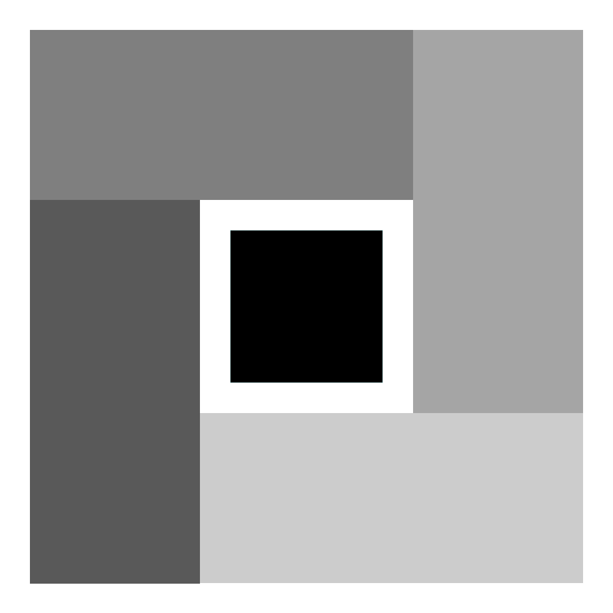

# Gridium

**English** | [简体中文](/README.zh.md)

---



Gridium is a UI layout framework for Minecraft Java Edition Fabric mods. It brings layout support to Minecraft's native rendering capabilities: describe what to draw and how to align it, and let the framework measure, arrange, and calculate the rendering positions, reducing the need to manually calculate screen coordinates.

The layout design is inspired by WPF (Windows Presentation Foundation), but the project focuses on UI in Fabric and Minecraft and does not aim to replace the native rendering API.

> This project is developed with AI assistance.

## Features

* Use `Size`, `Rect`, and `Thickness` to represent dimensions, layout bounds, and margins.
* Arrange elements using horizontal and vertical alignment options.
* Read an arranged element's content size with `getActualWidth()` and `getActualHeight()`; these include layout scaling, exclude margins, and are not affected by render transforms.
* Apply post-layout translation, scaling, and rotation with an adjustable normalized origin; render transforms do not affect layout size.
* `Grid` measures, arranges, and draws all its children within the available screen area.
* Pass layout results to Minecraft's native rendering API through `GuiGraphicsExtractor`.
* Currently supported drawing elements:
  + Text: supports `String`, `FormattedCharSequence`, and `Component`, with configurable color and shadow; `FormattedText` can be wrapped to a configured width, and `Component` can use Minecraft's text backdrop.
  + Text highlights: support the native highlight rectangle and its optional text inversion.
  + Rectangles: supports solid-color fills, as well as fills using `RenderPipeline` and `TextureSetup`.
  + Texture rectangles: support `Identifier` textures with normalized UV bounds, a render pipeline with pixel-based source regions, texture dimensions, and optional tint, or `GpuTextureView` with `GpuSampler`.
  + Gradient rectangles: supports setting the colors at both ends of the gradient.
  + Horizontal and vertical lines.
* Provides a test screen accessible through Mod Menu (an optional, recommended dependency).

`Grid` currently arranges its children within the entire screen area; it is not a table layout with row and column definitions. Multiple children can be aligned within the same area.

## Usage Example

Create elements in a `Screen` and add them to a `Grid`. Specify the drawing content and its properties when constructing an element, then use chained methods to declare alignment and margins. `Grid.draw(...)` lays out and draws the children using the current screen dimensions.

```java
private Grid grid;

@Override
protected void init() {
    grid = new Grid();

    grid.add(new Text(font, Component.literal("Gridium layout"), 0xFFFFFFFF)
        .setHorizontalAlignment(HorizontalAlignment.CENTER)
        .setVerticalAlignment(VerticalAlignment.TOP)
        .setMargin(new Thickness(0.0, 24.0, 0.0, 0.0)));

    grid.add(new GradientRectangle(180.0, 48.0, 0xFF202020, 0xFF405080)
        .setHorizontalAlignment(HorizontalAlignment.CENTER)
        .setVerticalAlignment(VerticalAlignment.CENTER));

    grid.add(new TextureRectangle(Gridium.id("icon.png"), 64.0, 64.0)
        .setHorizontalAlignment(HorizontalAlignment.CENTER)
        .setVerticalAlignment(VerticalAlignment.TOP)
        .setMargin(new Thickness(0.0, 48.0, 0.0, 0.0)));

    grid.add(new RectangleOutline(180.0, 48.0, 0xFFFFFFFF)
        .setHorizontalAlignment(HorizontalAlignment.CENTER)
        .setVerticalAlignment(VerticalAlignment.CENTER)
        .setRenderTransform(new RenderTransform(0.0, 0.0, 1.0, 1.0, 8.0))
        .setRenderTransformOrigin(0.5, 0.5));
}

@Override
public void extractRenderState(
    GuiGraphicsExtractor graphics,
    int mouseX,
    int mouseY,
    float partialTick
) {
    super.extractRenderState(graphics, mouseX, mouseY, partialTick);
    grid.draw(graphics);
}
```

In this example, `font` is the font provided by `Screen`. To use `Component`, import `net.minecraft.network.chat.Component`. Alignment and margin types are in the `me.hua.gridium.core` package, `Grid` is in `me.hua.gridium.layout`, and drawing elements are in `me.hua.gridium.controls`.

Use `setHorizontalAlignment(HorizontalAlignment.CENTER)` to center a text element in the available layout area. `Text.isCentered()` and `Text.setCentered(...)` are deprecated in favor of layout alignment.

To wrap formatted content, construct `Text` with a `FormattedText`, wrap width, color, and optional shadow flag. The wrap width is also the element's desired layout width; its desired height is measured from the wrapped line count, and rendering uses Minecraft's native `textWithWordWrap`.

To draw a component with Minecraft's configured text backdrop, construct `Text` with the component, text width, and text color. The element reserves the text width plus four pixels of horizontal backdrop padding and the native 13-pixel backdrop height; Minecraft supplies the configured background color and the native method draws the text with shadow.

`TextureRectangle` uses its layout bounds as the destination rectangle. Its default `Identifier` constructor samples the full texture using normalized UVs; the UV overload accepts explicit normalized bounds. The `RenderPipeline` overload instead accepts pixel source coordinates and dimensions plus the full texture dimensions, with an optional tint color. Source-region dimensions are independent of the destination size, so alignment or layout scaling does not change the sampled texture region.

For GPU textures, pass a `GpuTextureView` and `GpuSampler`; this native overload uses normalized UV bounds, the default GUI textured pipeline, and a white tint.

The render transform is configured as translation X/Y, scale X/Y, and rotation in degrees. Its normalized origin defaults to `(0.0, 0.0)` (top-left); `(0.5, 0.5)` rotates and scales around the center. Scale is applied first, then rotation, then translation. Render transforms do not affect layout or actual size.

Horizontal alignment options: `LEFT`, `CENTER`, `RIGHT`, and `STRETCH`. Vertical alignment options: `TOP`, `CENTER`, `BOTTOM`, and `STRETCH`.

## Build and Run

After cloning the repository, run the following command from the project root:

```bash
./gradlew build
```

Build artifacts are placed in `build/libs/`. To launch the development client, run:

```bash
./gradlew runClient
```

Install Mod Menu in the development client to view the current basic elements and layout behavior through Gridium's test screen.

## License

This project is licensed under GPL-3.0. See [LICENSE.md](LICENSE.md) for details.
