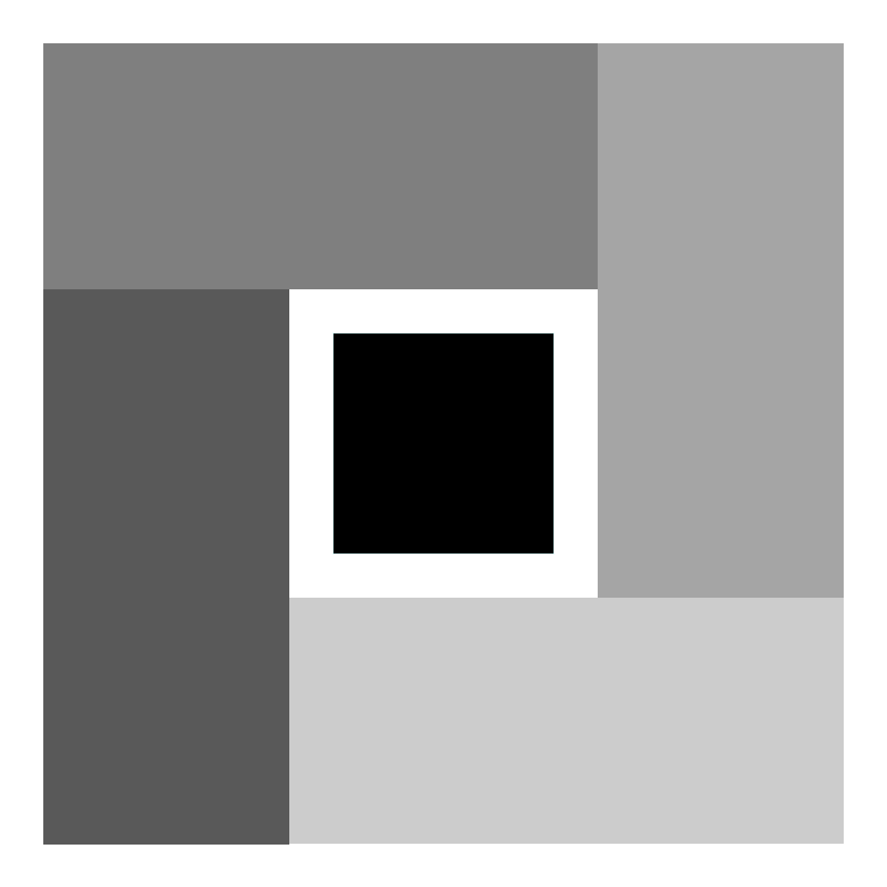

# Gridium

**English** | [简体中文](/README.zh.md)

---



**Gridium** is a UI layout framework for Minecraft Java Edition Fabric mods. It adds layout support to Minecraft's native rendering capabilities: developers describe what to draw and how to align it, while the framework measures, arranges, and calculates rendering positions—reducing the need to manually calculate screen coordinates.

The layout design is inspired by WPF (Windows Presentation Foundation), but this project focuses on UI scenarios for Fabric and Minecraft and does not aim to replace the native rendering API.

> This project is developed with the assistance of AI.

## Add Gridium as a Dependency

In a project using Fabric Loom, add the Modrinth Maven repository and declare Gridium as a dependency:

```gradle
repositories {
    maven {
        name = "Modrinth"
        url = "https://api.modrinth.com/maven"
        content {
            includeGroup "maven.modrinth"
        }
    }
}

dependencies {
    modImplementation "maven.modrinth:gridium:<version>"
}
```

Replace `<version>` with the version of Gridium published on Modrinth.

## License

This project is licensed under GPL-3.0. See [LICENSE.md](LICENSE.md) for details.
