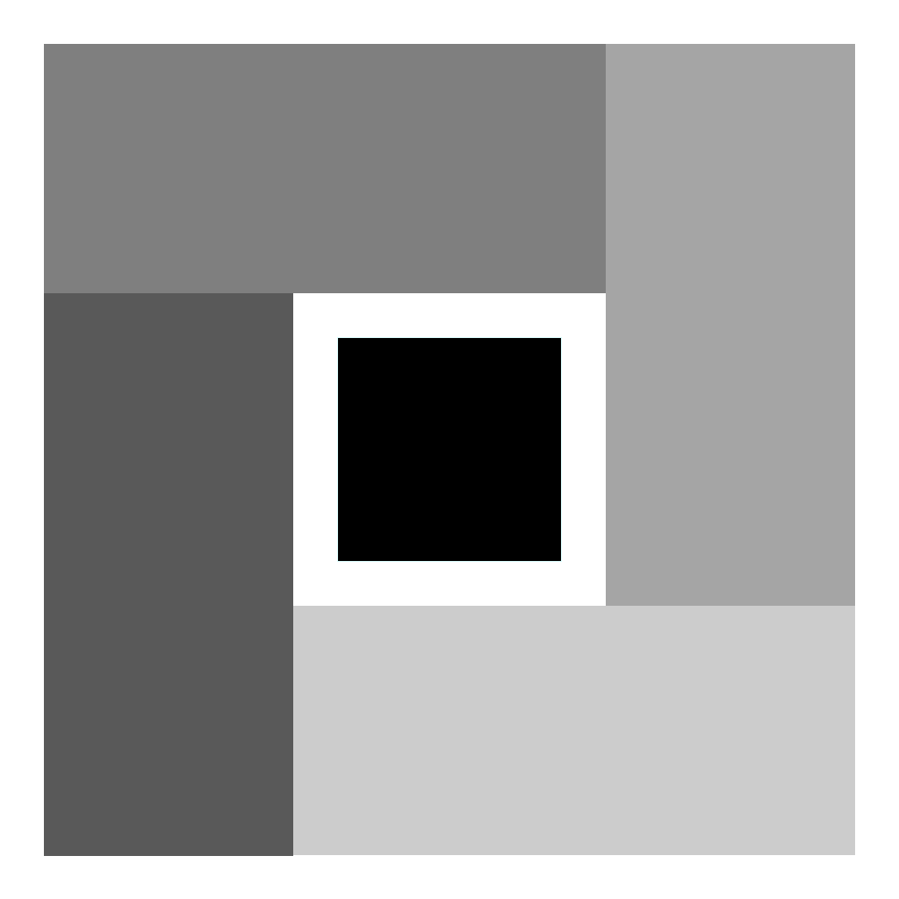

# Gridium

[English](/README.md) | **简体中文**

---



Gridium 是一个面向 Fabric Mod 的 Minecraft Java Edition UI 布局框架。它为 Minecraft 原生图形绘制能力提供布局支持，让开发者描述绘制内容及其对齐方式，由框架负责测量、排列和计算绘制位置，减少手工计算屏幕坐标的需要。

布局设计受到 WPF（Windows Presentation Foundation）启发，但项目专注于 Fabric 和 Minecraft 的 UI 场景，不试图取代原生绘制 API。

> 此项目使用AI进行辅助开发。

## 功能

* 使用 `Size`、`Rect` 和 `Thickness` 表达尺寸、布局边界和外边距。
* 使用水平和垂直对齐方式对元素进行布局。
* `Grid` 根据屏幕可用区域测量、排列并绘制所有子元素。
* 通过 `GuiGraphicsExtractor` 将布局结果交给 Minecraft 原生绘制 API。
* 当前绘制元素：
  + 文本：支持 `String`、`FormattedCharSequence` 和 `Component`，并可设置颜色及阴影。
  + 矩形：支持纯色填充，以及 `RenderPipeline` 和 `TextureSetup` 形式的填充。
  + 渐变矩形：支持设置渐变两端的颜色。
  + 水平线和垂直线。
* 提供可从 Mod Menu 打开的测试界面（Mod Menu 为可选推荐依赖）。

`Grid` 当前将子元素排列在整个屏幕区域中，并非具有行列定义的表格布局；多个子元素可以通过对齐方式安排在相同区域内。

## 使用示例

在 `Screen` 中创建元素并添加到 `Grid` 。构造绘制元素时提供绘制内容和内容属性；随后通过链式方法声明对齐和外边距。 `Grid.draw(...)` 会根据当前界面尺寸完成布局并绘制子元素。

```java
private Grid grid;

@Override
protected void init() {
    grid = new Grid();

    grid.add(new Text(font, Component.literal("Gridium layout"), 0xFFFFFFFF)
        .setHorizontalAlignment(HorizontalAlignment.CENTER)
        .setVerticalAlignment(VerticalAlignment.TOP)
        .setMargin(new Thickness(0.0, 24.0, 0.0, 0.0)));

    grid.add(new GradientRectangle(180.0, 48.0, 0xFF202020, 0xFF405080)
        .setHorizontalAlignment(HorizontalAlignment.CENTER)
        .setVerticalAlignment(VerticalAlignment.CENTER));
}

@Override
public void extractRenderState(
    GuiGraphicsExtractor graphics,
    int mouseX,
    int mouseY,
    float partialTick
) {
    super.extractRenderState(graphics, mouseX, mouseY, partialTick);
    grid.draw(graphics);
}
```

示例中的 `font` 是 `Screen` 提供的字体；使用 `Component` 时需要导入 `net.minecraft.network.chat.Component` 。对齐类型和边距类型分别位于 `me.hua.gridium.core` 包， `Grid` 位于 `me.hua.gridium.layout` 包，绘制元素位于 `me.hua.gridium.controls` 包。

水平对齐方式： `LEFT` 、 `CENTER` 、 `RIGHT` 、 `STRETCH` 。垂直对齐方式： `TOP` 、 `CENTER` 、 `BOTTOM` 、 `STRETCH` 。

## 构建与运行

克隆仓库后，在项目根目录执行：

```bash
./gradlew build
```

构建产物位于 `build/libs/` 。如需启动开发客户端，可执行：

```bash
./gradlew runClient
```

开发客户端中安装 Mod Menu 后，可以通过 Gridium 的测试界面查看当前基础元素和布局效果。

## 许可证

本项目使用 GPL-3.0 许可证，详见 [LICENSE.md](LICENSE.md)。
