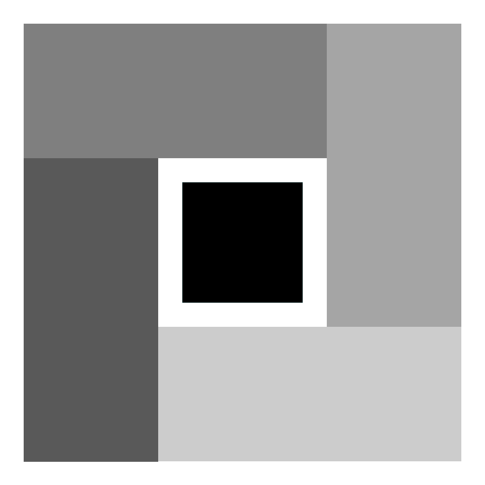

# Gridium

[English](/README.md) | **简体中文**

---



**Gridium** 是一个面向 Minecraft Java Edition Fabric Mod 的 UI 布局框架。它为 Minecraft 原生图形绘制能力提供布局支持：开发者描述绘制内容和布局意图，Gridium 负责测量、排列并计算绘制位置，减少手工计算屏幕坐标的需要。

Gridium 的设计受到 [WPF](https://github.com/dotnet/wpf)（Windows Presentation Foundation）启发，但专注于 Fabric 和 Minecraft 的 UI 场景，不试图取代 Minecraft 原生绘制 API。

> *此项目使用 AI 辅助开发。*

## 在项目中添加依赖

在使用 Fabric Loom 的项目中，将 Modrinth Maven 仓库添加到仓库列表，并在依赖中声明 Gridium：

```gradle
repositories {
    maven {
        name = "Modrinth"
        url = "https://api.modrinth.com/maven"
        content {
            includeGroup "maven.modrinth"
        }
    }
}

dependencies {
    modImplementation "maven.modrinth:gridium:<version>"
}
```

请将 `<version>` 替换为 Gridium 在 Modrinth 上发布的版本号。

## 快速开始

下面的示例展示了在 `Screen` 中创建 Grid、添加文本和纵向 `StackPanel` ，并在 Screen 的渲染状态提取阶段绘制布局。

```java
import me.hua.gridium.controls.Rectangle;
import me.hua.gridium.controls.Text;
import me.hua.gridium.core.HorizontalAlignment;
import me.hua.gridium.core.Thickness;
import me.hua.gridium.layout.Grid;
import me.hua.gridium.layout.StackPanel;
import net.minecraft.client.gui.GuiGraphicsExtractor;
import net.minecraft.client.gui.screens.Screen;
import net.minecraft.network.chat.Component;

public final class ExampleScreen extends Screen {
    private Grid grid;

    public ExampleScreen(Screen parent) {
        super(Component.literal("Example screen"));
    }

    @Override
    protected void init() {
        grid = new Grid();

        grid.add(new Text(font, Component.literal("Gridium"), 0xFFFFFFFF)
                .setHorizontalAlignment(HorizontalAlignment.CENTER)
                .setMargin(new Thickness(0, 24, 0, 0)));

        var content = new StackPanel()
                .setSpacing(8);
        content.add(new Rectangle(120, 24, 0xFF3F76E4));
        content.add(new Text(font, "Laid out without manual coordinates", 0xFFFFFFFF, false));
        grid.add(content
                .setHorizontalAlignment(HorizontalAlignment.STRETCH)
                .setMargin(new Thickness(16, 56, 16, 16)));
    }

    @Override
    public void extractRenderState(
            GuiGraphicsExtractor graphics,
            int mouseX,
            int mouseY,
            float partialTick
    ) {
        super.extractRenderState(graphics, mouseX, mouseY, partialTick);
        grid.draw(graphics, mouseX, mouseY, partialTick);
    }
}
```

`Grid` 默认从其布局区域的左上方开始排列子元素。上例将标题水平居中，并在标题下方放置一个纵向排列的内容区域。

### 桥接 Minecraft 原生 Native

Minecraft Widget 不受 GuiGraphicsExtractor 管理。需要将其构建之后注册到 Screen 的输入系统，再用 `MinecraftWidget` 桥接进 Grid。此示例使用 `net.minecraft.client.gui.components.Button` ：

```java
var button = Button.builder(Component.literal("Click me"), clicked -> {
    clicked.setMessage(Component.literal("Clicked"));
}).size(96, 20).build();

addWidget(button);
grid.add(new MinecraftWidget(button)
        .setHorizontalAlignment(HorizontalAlignment.CENTER)
);
```

这里的 `MinecraftWdiget` 作为桥接控件，仅控制其布局，无法控制其他内容

## 许可证

本项目使用 GPL-3.0 许可证，详见 [LICENSE.md](LICENSE.md)。
